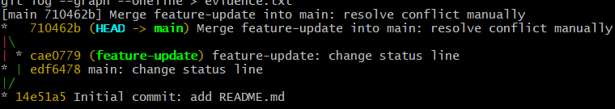

# Báo cáo: Tạo và xử lý Merge Conflict trong Git

## 1. Mục tiêu

Tạo một tình huống xung đột (merge conflict) có chủ đích giữa hai nhánh `main` và `feature-update` khi cả hai cùng sửa một dòng trong `README.md`, sau đó xử lý xung đột thủ công và hoàn tất merge.

## 2. Các bước thực hiện

### Bước 1: Khởi tạo repo và commit đầu tiên trên `main`

```bash
git init -b main
echo "# Git Merge Conflict Demo" > README.md
echo "Status: initial version" >> README.md
git add README.md
git commit -m "Initial commit: add README.md"
```

### Bước 2: Tạo nhánh `feature-update` và sửa dòng 2 của `README.md`

```bash
git switch -c feature-update
# Sửa dòng 2 thành: Status: updated on feature-update branch
git add README.md
git commit -m "feature-update: change status line"
```

### Bước 3: Quay lại `main` và sửa cùng dòng đó theo cách khác

```bash
git switch main
# Sửa dòng 2 thành: Status: updated on main branch
git add README.md
git commit -m "main: change status line"
```

### Bước 4: Merge `feature-update` vào `main` → xảy ra conflict

```bash
git merge feature-update
# Auto-merging README.md
# CONFLICT (content): Merge conflict in README.md
# Automatic merge failed; fix conflicts and then commit the result.
```

### Bước 5: Sửa `README.md` thủ công, xóa các marker `<<<<<<<`, `=======`, `>>>>>>>`

```bash
# Mở README.md bằng editor, giữ lại nội dung mong muốn
# và xóa toàn bộ các dòng marker <<<<<<<, =======, >>>>>>>
code README.md
```

### Bước 6: `git add` + `git commit` để hoàn tất merge

```bash
git add README.md
git commit -m "Merge feature-update into main: resolve conflict manually"
```

### Bước 7: Xem lịch sử commit dạng đồ thị

```bash
git log --graph --oneline
```

## 3. Nội dung conflict

Khi chạy `git merge feature-update`, Git ghi vào `README.md` nội dung sau:

```text
# Git Merge Conflict Demo
<<<<<<< HEAD
Status: updated on main branch
=======
Status: updated on feature-update branch
>>>>>>> feature-update
```

Giải thích ba marker:

- `<<<<<<< HEAD`: bắt đầu phần nội dung của nhánh hiện tại (`main`, nơi `HEAD` đang trỏ tới).
- `=======`: đường phân cách giữa hai phiên bản.
- `>>>>>>> feature-update`: kết thúc phần nội dung đến từ nhánh được merge vào (`feature-update`).

## 4. 3-Way Merge

Khi merge, Git không chỉ so sánh hai nhánh mà so sánh **ba** phiên bản:

1. **Common ancestor** (commit tổ tiên chung, ở đây là `14e51a5`): `Status: initial version`
2. **Tip của `main`** (`edf6478`): `Status: updated on main branch`
3. **Tip của `feature-update`** (`cae0779`): `Status: updated on feature-update branch`

Nếu chỉ một bên thay đổi một dòng so với tổ tiên chung, Git tự động lấy thay đổi đó. Nhưng ở đây **cả hai bên đều sửa cùng một dòng theo hai cách khác nhau**, nên Git không thể tự quyết định giữ phiên bản nào. Git dừng lại, đánh dấu vùng xung đột bằng các marker và yêu cầu người dùng xử lý thủ công.

## 5. Kết quả (`git log --graph --oneline`)

```text
*   710462b Merge feature-update into main: resolve conflict manually
|\
| * cae0779 feature-update: change status line
* | edf6478 main: change status line
|/
* 14e51a5 Initial commit: add README.md
```

Ảnh chụp màn hình:


